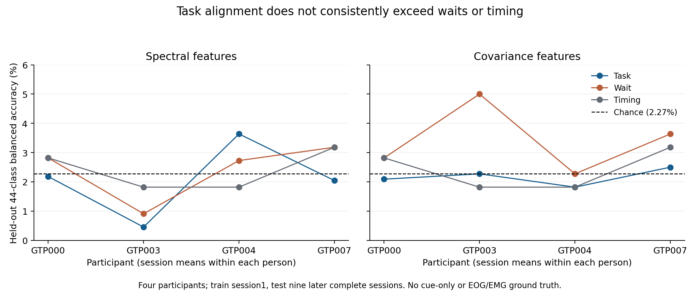
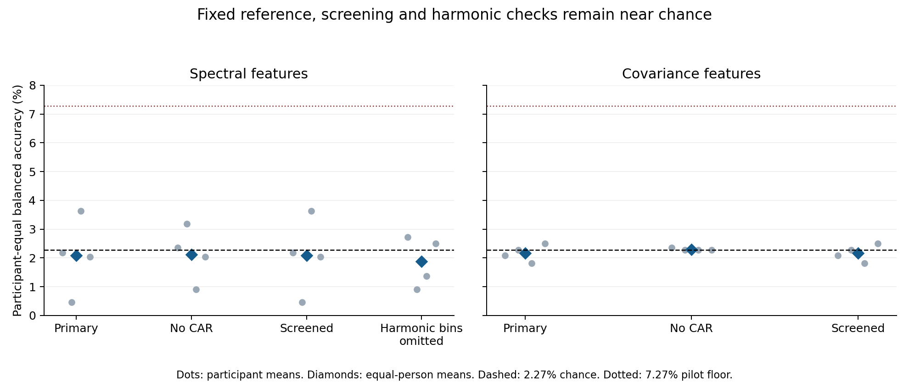
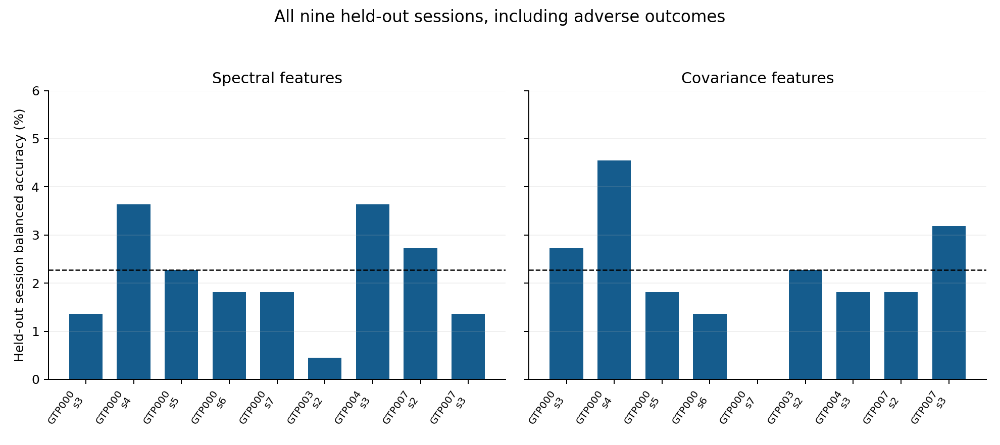

# Independent-session analysis of John’s EEG delivery

6 October 2026. Exploratory author-review analysis; no manuscript replacement, submission or public deposit.

**The fixed analysis did not find useful repeatability of the 44 recorded stimulus indices across sessions. Both primary pipelines remain near the 2.27% chance level and fail the predeclared pilot criterion. These results do not support moving into composition/augmentation testing with this bank under this design.**

The recordings provide a stronger test of the bank than the original single-session demonstration: four reported people, 13 structurally complete sessions, 572 source files and 2,860 unique marked recall intervals. They do not provide continuous imagined sentences, cue-only recordings, separate EOG/EMG controls or independent metabolic measurements.

## Primary result

| Fixed family | Mean balanced accuracy | Descriptive participant-bootstrap 95% interval | Conditional alignment p | Holm p | People above chance | Pilot gate |
|---|---:|---:|---:|---:|---:|---|
| Spectral | 2.08% | [0.89%, 3.24%] | 0.626 | 1.000 | 1/4 | Fail |
| Covariance | 2.17% | [1.93%, 2.40%] | 0.607 | 1.000 | 1/4 | Fail |

Each participant’s first complete session supplies 220 training recalls. All remaining complete sessions are held out: 1,980 real recalls in nine sessions. Five recalls from a file always stay together. Preprocessing and class centroids fit no test observations. All 44 labels are retained. Results first average sessions within a person, then weight the four people equally; John’s extra sessions therefore do not dominate the mean.

The locally frozen criterion requires at least 7.27% group accuracy, at least three of four people above chance, and Holm p<0.05 across the two primary families. The five-percentage-point practical floor was chosen for this pilot; it is not a publication standard or clinical utility threshold. The bootstrap resamples four people 10,000 times, so its interval is discrete and unstable. It is not population validation. The 999-permutation test is conditional on exchangeability of class identities, not a test that a signal is neural or caused by imagination.

| Participant | Held-out sessions | Spectral task | Covariance task | Spectral wait | Covariance wait | Timing only |
|---|---|---:|---:|---:|---:|---:|
| GTP000 | 3, 4, 5, 6, 7 | 2.18% | 2.09% | 2.82% | 2.82% | 2.82% |
| GTP003 | 2 | 0.45% | 2.27% | 0.91% | 5.00% | 1.82% |
| GTP004 | 3 | 3.64% | 1.82% | 2.73% | 2.27% | 1.82% |
| GTP007 | 2, 3 | 2.05% | 2.50% | 3.18% | 3.64% | 3.18% |



## Controls and fixed sensitivities

| Condition | Family | Equal-person accuracy | File-mean accuracy |
|---|---|---:|---:|
| harmonic | spectral | 1.87% | 1.25% |
| no_car | covariance | 2.30% | 2.16% |
| no_car | spectral | 2.12% | 0.91% |
| screened | covariance | 2.17% | 2.16% |
| screened | spectral | 2.08% | 1.99% |
| task | covariance | 2.17% | 2.16% |
| task | spectral | 2.08% | 1.99% |
| timing | timing | 2.41% | 2.22% |
| wait | covariance | 3.43% | 3.24% |
| wait | spectral | 2.41% | 1.02% |

File-mean accuracy is the same fixed centroid model applied to the mean feature vector of each held-out file; it is not an additional biological replicate.

- Spectral task minus wait: -0.33 percentage points; descriptive participant-bootstrap interval [-0.97, +0.52].
- Spectral task minus timing: -0.33 percentage points; descriptive participant-bootstrap interval [-1.25, +1.08].
- Covariance task minus wait: -1.26 percentage points; descriptive participant-bootstrap interval [-2.23, -0.59].
- Covariance task minus timing: -0.24 percentage points; descriptive participant-bootstrap interval [-0.70, +0.23].

The task does not outperform these controls on the participant-equal mean. Waits may contain carryover or an early visual cue and are not a separately collected cue-only baseline. Timing features use acquisition rank, marker ordinal, interval duration, sample count and packet counter. Their near-chance outcome does not prove absence of every timing/order confound.

Dropping CAR, omitting predefined harmonic neighborhoods and applying the training-only amplitude/derivative screen do not reach the pilot floor. The screen rejects **zero** recalls; its threshold is a relative outlier diagnostic, not evidence that these recordings are artifact-free. Removing selected spectral bins is also not proof of removal of interference. No filters or thresholds were tuned after results.



John’s different-day diagnostic trains sessions 1,3,4 from 21 March and tests 5,6,7 from 23 March. It is a separate single-person result, not a fifth person or an independent cohort:

- Covariance: 1.97% recall accuracy; 2.27% file-mean accuracy.
- Spectral: 2.58% recall accuracy; 0.76% file-mean accuracy.

## Signal and provenance limitations

Original units, gain, reference, processing history and exact executed stimulus-deck identity remain unverified. The earlier fixed raw traces show pronounced periodic waveforms and harmonic peaks near multiples of 10 Hz, as well as substantial common signal. Their cause has not been diagnosed. Relative spectral power and scale-normalized covariance reduce dependence on absolute gain but do not establish neural signal quality.

The covariance model often assigns most or all test recalls in a session to one index. This is documented in `prediction_class_use.csv`; no classes were removed or model family substituted to hide it. Such predictions can achieve nominal chance by guessing one class in a balanced session. A near-chance aggregate should not be mistaken for a weak but validated decoder.

1/9 covariance test sessions predict exactly one class. All per-session scores are shown below.



Exact duplicated/misplaced files and truncated files were excluded through the author-confirmation manifest before fitting. The entire affected incomplete session is omitted, rather than replacing its absent index with another session’s copy. All raw archives and files remain preserved. Duplicate ownership is supported by recorded timestamps, not by an original acquisition log.

The primary label is the recorded integer index, not a fully validated distinct phoneme interpretation. The supplied 16-slide object deck and recovered 91-slide phoneme candidate are still not established as the same executed stimulus version. Even a correct phoneme mapping would leave visual-cue and instructed-imagination effects confounded.

## Consequence for the paper

This run supplies an independent-session check that the original bank lacked. Its contribution is a transparent test and a limit on the bank’s demonstrated usefulness, not improved biological reconstruction performance. There is no evidence here that a correctly ordered phoneme splice resembles a genuinely imagined sentence, or that composition improves prediction of held-out real EEG.

The appropriate present conclusion is: **“In a fixed exploratory analysis of four participants, relative spectral and covariance centroid classifiers did not establish reliable 44-index alignment across held-out sessions. These results limit the demonstrated utility of the recorded bank for label-dependent EEG composition under the tested design.”** Do not write “phonemes contain no EEG information” or generalize this failure to all imagined-speech methods.

The prior FEIS and Kara analyses remain separate adverse results; this delivery does not supersede them or create a successful replication. Any revised paper should acknowledge the sequence of exploratory analyses and avoid presenting the newest dataset as a prospectively independent confirmation of a favorable effect.

The Rothman/DiNuzzo physiology framework remains theoretical context for an illustrative model. More EEG recordings do not calibrate the imposed gamma-to-CMRO2 input or independently validate CBF, oxygen extraction, pH, gases or lactate. The downstream variables share one deterministic driver and cannot be counted as independent measured physiological outcomes.

The current v1.27 source-space outputs also use an inherited channel assignment that differs from John’s confirmed order in 14 of 16 positions. Regenerate those outputs and electrode labels before relying on them; this index-level analysis does not repair or endorse those manuscript figures.

## Recommended next action

1. **Review acquisition quality before collecting or modeling more.** Resolve units/gain/reference/processing and investigate the periodic raw pattern against the equipment and acquisition logs. These results cannot distinguish poor recording quality from weak or poorly captured task information. Do not start another open-ended classifier search to obtain a positive score.
2. **Choose a defensible manuscript question with the authors.** The existing data support a construction demonstration with a candid independent-session feasibility failure and explicit model assumptions. That is narrower than biological speech or metabolism reconstruction, and its publication value still needs a concrete reproducibility or simulation use. No acceptance guarantee follows from a careful negative analysis.
3. **If biological reconstruction remains the aim, design the required study.** Use matched isolated units and independently recorded continuous sequences, randomized order, verified event timing, cue-only and eye/muscle controls, repeats on separate days and a justified participant/precision plan. Test acquisition and a fixed real-data baseline first. Metabolic calibration requires independent physiological measurements in a separate justified study.
4. **Resolve the remaining submission requirements.** Exact stimulus crosswalk, four-person demographics/consent/reuse, approved data/code release and corrected spatial figures remain outstanding. Neither the manuscript nor reviewer response was silently upgraded by this analysis.

## Reproduction and verification

Protocol: `research/john_phoneme_analysis/PROTOCOL.md`, saved before classifier scores on this delivery. This is a local exploratory plan, not external preregistration; original session1, raw signal examples and prior public-dataset results had already been inspected. Two fixed feature families and a transparent nearest-centroid classifier were used, with no hyperparameter search or results-based sample selection.

Detailed data, epochs, feature cache, predictions and nulls: `D:/ResearchData/thinktank-clearmind/John/2026-10-05/analysis/phoneme_repeatability_v1`. Original archives and source recordings remain on D:. Only summaries and figures are in this repository.

```powershell
python -m unittest discover -s research/john_phoneme_analysis -p test_analysis.py -v
# First two stages refuse overwriting a completed run:
python research/john_phoneme_analysis/analyze.py extract
python research/john_phoneme_analysis/analyze.py evaluate
# Replay verification and regenerate derivative reports:
python research/john_phoneme_analysis/verify_report.py
```

Independent verification: **572 source SHA-256 receipts**, **2860 unique full-task signals**, **80 fixed source windows re-extracted**, **21,120 saved predictions replayed**, **96 session scores and eight conditional null arrays recovered**. A labeled positive fixture, train-only scaling isolation, actual label-refit/null equivalence and feature-scale/filter invariants pass the five unit tests.

Artifacts: `summary.json`, `participant_results.csv`, `session_results.csv`, `condition_summary.csv`, `prediction_class_use.csv`, `screen_thresholds.csv`, `verification.json`, three PNG/PDF figure pairs, and this report. Saved predictions in repeated controls are not additional biological samples.
